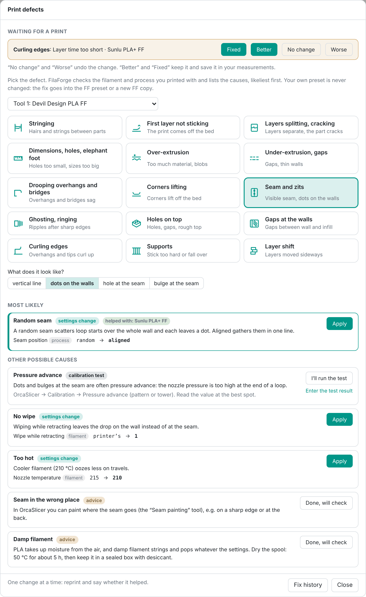

<p align="center">
  <picture>
    <source media="(prefers-color-scheme: dark)" srcset="docs/logo-dark.jpg">
    
  </picture>
</p>

<p align="center">
  <a href="https://github.com/xtronets/filaforge/releases/latest"></a>
  <a href="https://github.com/xtronets/filaforge/actions/workflows/build.yml"></a>
  <a href="LICENSE"></a>
</p>

<p align="center"><a href="README.md">Polski</a> · <b>English</b></p>

# FilaForge

An OrcaSlicer plugin that builds filament profiles from open databases, the maker's data sheet and your own
measurements. Every value shows where it came from and how sure it is.

<p align="center"></p>

## New in 0.7.0: print defects

Something went wrong in a print? Click **Defects**, pick the problem and answer a question or two. FilaForge
looks at the filament and process you printed with and lists the causes, likeliest first, from the material,
your settings, your measurements and what you already tried. Fixes are calculated from data, not guessed, and
when no setting fixes it (drying, washing the plate, Z offset) it says so.

You change one thing at a time and say after the print whether it helped. Changes that help stay and go into
your measurements; the others are undone. Your own presets stay untouched: fixes go into FF presets.
Details in [Print defects](#print-defects).

<p align="center"></p>

## Contents

- [What it does](#what-it-does)
- [Where the data comes from](#where-the-data-comes-from)
- [How a value is chosen](#how-a-value-is-chosen)
- [A print process for the filament](#a-print-process-for-the-filament)
- [Material habits](#material-habits)
- [Preset review and history](#preset-review-and-history)
- [Print defects](#print-defects)
- [Requirements](#requirements)
- [Install, update, uninstall](#install-update-uninstall)
- [How to use it](#how-to-use-it)
- [Settings](#settings)
- [What it stores and where](#what-it-stores-and-where)
- [Privacy and network](#privacy-and-network)
- [Troubleshooting](#troubleshooting)
- [Development](#development)
- [License](#license)

## What it does

- **Finds data about a filament** picked from Spoolman, from your OrcaSlicer presets or typed in (brand,
  material, kind) in several sources at once, and shows it in one table.
- **Improves the presets you already have**: on the *From OrcaSlicer* tab you pick one of your filament
  presets, and FilaForge fills it with the maker's data and saves it as a new preset marked FF. Your preset
  stays as it is, and its values (such as a flow ratio you set by hand) win over the maker's presets.
- **Reads makers' data sheets (TDS)** from a PDF file, or from the address of a PDF or product page: nozzle
  temperatures (including ranges that depend on print speed), bed, retraction, density, Vicat/HDT and drying.
- **Creates a filament preset in OrcaSlicer** in one click. It is a standalone preset with its own
  `filament_id`, so *Sync from AMS* and printer agents (such as U1 Control) can match it. The name carries the
  **FF** mark (e.g. `Sunlu PLA+ FF`), and the preset is limited to the selected printer.
- **Saves settings to Spoolman**, in the filament's `orca_settings` field, for every printer or only this
  printer model. Missing settings are added; settings already there with another value (such as an old
  flow ratio) are overwritten only when you tick them. Before writing you see what will be added, overwritten
  and kept. [Spooler](https://github.com/bloodf/spooler) turns them into presets.
- **Keeps your measurements**: nozzle and bed temperature, flow ratio, pressure advance, max flow and
  retraction. They are stored per filament, for every printer or one, and always win. Pressure advance and
  max flow are kept per nozzle diameter (0.4, 0.6…), since a value measured on 0.4 is wrong for 0.6.
- **Helps with OrcaSlicer's calibration**: for the flow ratio (YOLO, Pass 1/2), max flow, pressure advance,
  temperature and retraction tests it says how to read the result, works it out with the formulas from the
  OrcaSlicer wiki and puts it into your measurements.
- **Diagnoses print defects**: stringing, the first layer, layers splitting, dimensions, over- and
  under-extrusion, overhangs and bridges, and lifting corners. It orders the causes by material, settings and
  measurements, fixes one thing at a time and learns from how the print came out.
- **Knows material habits**: slower PETG bridges, the bridge fan, the chamber and fan-free first layers for
  ABS/ASA/PC/PA, a warning for an open printer. Every factor can be changed in the **Materials** window.
- **Keeps presets in order**: **Review** finds missing and conflicting values and presets left behind by an
  OrcaSlicer update, and brings changes you made by hand in OrcaSlicer into your measurements.
- **Keeps a history**: before an FF preset is replaced or removed, the earlier version is kept to compare
  and restore.
- **Calculates a print process for the filament**: speeds lowered to its max flow, material habits, bridges,
  accelerations, printer limits and a variant for small parts.
- **Polish and English interface**, in OrcaSlicer's light and dark themes.
- **Works offline** with OrcaSlicer's presets, your measurements and answers fetched earlier.

## Where the data comes from

| Source | What it gives | Kind |
|---|---|---|
| [Open Filament Database](https://openfilamentdatabase.org) (MIT) | nozzle and bed ranges, density, max flow, fan, drying, the data sheet's address, the matching OrcaSlicer preset | maker |
| The maker's data sheet (PDF or product page) | nozzle range per print speed, bed, retraction, Vicat/HDT, density, drying | maker |
| [SpoolmanDB](https://github.com/Donkie/SpoolmanDB) (MIT) | temperatures, density | maker |
| OrcaSlicer's presets | the maker's preset for this filament on your printer, and the generic preset of the material | preset / generic |
| Your preset picked on the *From OrcaSlicer* tab | the values you print with now; it is the new preset's base | preset (ahead of the maker's preset) |
| Your measurements, and the `orca_settings` already in Spoolman | anything you calibrated | tested |

## How a value is chosen

Each setting in the table has a value, its origin (colour), a confidence (bars) and the values the other
sources gave. Confidence rises when sources agree.

Order of precedence:

1. **Tested**: your measurement always wins.
2. **Maker**: values declared in the databases and the data sheet. Nozzle and bed temperatures are picked
   inside the maker's range, by how trustworthy each source is. When the data sheet gives temperatures per
   print speed, the band matching your printer's process speed is used.
3. **Preset**: a value from an OrcaSlicer preset is kept only when it is inside the maker's range.
4. **Estimated**: e.g. max flow worked out from the maker's print speed.
5. **Generic**: the material's generic preset value, when there is nothing better.

You tick which settings go into the preset and into Spoolman. Settings equal to the base preset are hidden by
default; a link below the table shows them.

## A print process for the filament

The **Print process for this filament** card takes the selected printer process and makes a copy that
inherits it (`inherits`), changing only what is needed:

- **Speeds** are capped at the filament's max flow: v = flow / (h · (w − h·(1 − π/4))), where h is the layer
  height and w the line width. This covers walls, infill, top surface, gap fill, small perimeters, scarf seams,
  supports and their interface, and bridges. Bridges use the cross-section of a round strand.
- **Material habits**: PETG and silk PLA get slower outer walls and top surfaces. ABS, ASA and carbon-filled
  materials are a little slower, PC and PA about 70%. TPU runs at about 30%, never above 60 mm/s, with gentler
  accelerations. You can change every one of these factors, see [Material habits](#material-habits).
- **Bridges**: PETG gets slower bridges (×0.8), since a slow bridge with a gentle fan strings and sags less.
  PLA stays as it is. The bridge acceleration is set so a bridge reaches its speed in about 25 ms and the
  strand isn't torn at the start (at least 500 mm/s²).
- **Printer limits**: no speed or acceleration goes above the machine limits in the printer profile.
- **Variants**: *Regular parts*, *Small parts (up to 40 mm)* with slower walls and accelerations, or
  *From the parts on the plate*, which picks the variant from the sizes of the models on the plate.

Every change shows the current value, the new one and the reason. The process is saved in OrcaSlicer as,
for example, `0.20mm Standard Sunlu PLA+ FF`.

## Material habits

The **Materials** button in the header opens the table of rules FilaForge uses for each kind of material (PLA,
silk PLA, PETG/PCTG, ABS, ASA, PC, PA, carbon-filled, TPU). They are rules of thumb, not the maker's data, so
you can change them. Changes are kept in `settings.json`; **Restore defaults** goes back to FilaForge's values.

- **Speeds and accelerations (×)**: process factors for the outer wall, inner walls, top, infill, bridges and
  accelerations. 1 = unchanged. An empty field in a group takes the "All" column. A factor only lowers a
  speed, it never raises one.
- **Cooling** (the second table):
  - **Min and Max (%)** (`fan_min_speed`, `fan_max_speed`): part fan on long and short layers. By default
    PLA and TPU 100/100, PETG 30/60, ABS 10/30, ASA 10/35, PC 0/30, PA 0/40.
  - **Bridges (%)** (`overhang_fan_speed`): part fan on bridges and overhangs. By default PLA 100%, PETG 60%,
    ABS and ASA 50%, PC and PA 40%.
  - **Full from layer** (`full_fan_speed_layer`): from this layer the part fan runs at full speed. PLA and
    PETG 3, ABS, ASA and PA 4, PC 5.
  - **Min layer time (s)** (`slow_down_layer_time`): a shorter layer slows down and gets the highest fan.
    PLA 8, PETG 10, ABS, ASA and PA 12, PC 15.
  - **Aux (%)** (`additional_cooling_fan_speed`): the auxiliary fan. PLA 70%, PETG 20%, materials that warp
    0%. Set only when the printer profile has an auxiliary fan (`auxiliary_fan`).
- **Layers without fan** (`close_fan_the_first_x_layers`): ABS and ASA 3, PC 4, PA 3, so the first layers
  stick to the bed.
- **Chamber** (`chamber_temperature`): ABS and ASA 45 °C, PC 55 °C, PA 45 °C. Set only when the printer
  profile has chamber temperature control (`support_chamber_temp_control`); FilaForge then also turns on
  `activate_chamber_temp_control`.
- **Needs enclosure**: ABS, ASA, PC and PA. When the printer doesn't heat its chamber and nothing says it is
  closed, the result and the process show a warning with a **My printer is enclosed** button. FilaForge
  remembers that for the printer and then suggests warming the inside up before printing instead.

The filament preset values show as **Estimate** in the results table. A maker's preset, a data sheet and your
own measurement win over them; they only replace the value of the material's generic preset.

## Print defects

The **Defects** button in the header helps fix what went wrong in a print. Pick the defect from the list:

stringing · first layer not sticking · layers splitting and cracking · dimensions, holes, elephant foot ·
over-extrusion · under-extrusion · drooping overhangs and bridges · corners lifting · seam and zits ·
ghosting (ringing) · holes on top · gaps at the walls · curling edges · supports · layer shift.

**A diagnosis, not one fixed tweak.** Every defect has several possible causes. FilaForge puts them in order,
likeliest first, from:

- **the material**: PETG and nylon get drying first; ABS/ASA/PC in an open printer get the enclosure first;
  PLA in a closed printer can overheat the heatsink;
- **the settings you printed with**: the temperature within the preset's range, direct drive or Bowden
  retraction, fan, flow, brim; a fix never goes outside the preset's range or the material's limits (e.g. a PLA
  bed stays at 65 °C or below);
- **your answers** to one or two questions, e.g. whether the filament was dried or where the layer lets go;
- **your measurements**: sizes from calipers, a single wall's thickness, a saved flow ratio;
- **what you already tried** on this filament.

How some fixes are calculated:

- **Dimensions**: from two different outside sizes (e.g. 20 and 100 mm) FilaForge tells material shrinkage
  (`filament_shrink`) from walls that are offset (`xy_contour_compensation`). Holes get their own compensation.
  When the outside is too big and the holes too small by about the same, it asks for a flow calibration first.
- **Flow ratio from a wall**: a cube in vase mode, the wall measured with calipers, new flow ratio =
  flow ratio × line width / measured wall.

Some causes aren't settings: drying, washing the plate, levelling, Z offset, a clogged nozzle, a draft, a
loose belt, resonance calibration. FilaForge says so instead of changing something blindly.

**Test prints.** Where a test beats guessing, the cause names the OrcaSlicer calibration test (flow, pressure
advance, max flowrate, temperature tower, retraction, input shaping) and what to read from it. **Enter the
test result** takes you to the calculator in "Your measurements" with that test picked, so the result goes
straight into your measurements.

**One change at a time, and a loop after the print.** The change goes into the FF filament or process preset
(with its history). When you printed with your own preset, FilaForge makes an FF copy of it and fixes that.
After the print, answer in the same window:

| Answer | What happens |
|---|---|
| Fixed, Better | The change stays. Filament values go into your measurements, so the next preset gets them too. After "Better" the plan can offer the next step of the same cause. |
| No change, Worse | The change is undone and that cause drops to the bottom of the list. Go on to the next one. |

**Fix history.** The **Fix history** button in the Defects window lists every attempt for the filament on the
plate (or for all filaments): the defect, the cause, the changed values, the preset, the outcome and the date.
FilaForge learns from it: a fix that helped another filament of the same kind on the same printer moves up the
plan with a "helped with: …" tag, and one that didn't moves a little down.

## Preset review and history

The **Review** button in the header checks the filament presets FilaForge made and your own; the number on it
says how many things are worth a look. Presets not made by FilaForge are never changed: they can only be opened
in FilaForge to make a new preset from them.

| What it finds | What you can do |
|---|---|
| **You changed a value by hand in OrcaSlicer**: PA, flow, max flow, temperatures, retraction or fan, in an FF preset or a preset saved from one | **Keep as my measurement**: the value goes into your measurements (for that printer and nozzle), so the next preset gets it too; when the preset was made from a spool, into Spoolman as well. Or **Leave it, don't ask**. |
| **Your measurement differs from an FF preset** | **Put measurement in preset** |
| **OrcaSlicer updated the base preset** (e.g. after an OrcaSlicer update) | **Refresh on the new base**: the base's new values, while what FilaForge set and what you changed stays |
| Base preset gone, preset file deleted by hand, OrcaSlicer didn't load a preset | Remove from list, Repair (processes), Remove |
| No max flow, PA on but 0, nozzle temperature outside the preset's range, min fan above max, missing parent preset | **Open in FilaForge** |
| Presets with identical settings | information; an FF duplicate can be removed |

The review also runs on its own when the tab opens, and tells you when it notices a change made in OrcaSlicer.

**History** (**Saved** → **History…**): before FilaForge replaces or removes one of its presets, it keeps the
earlier version, up to 20 per preset. Compare any of them with the current one (**Show changes**) and restore it.
Restoring keeps the current version too, so a restore can be undone. A removed preset comes back with the printer
and spool it was made for.

## Requirements

- OrcaSlicer **2.5** or newer, with plugin support.
- Optional: [Spoolman](https://github.com/Donkie/Spoolman), to pick spools and save settings. Everything else works without it.
- Optional: [Spooler](https://github.com/bloodf/spooler). If you have it, FilaForge takes the Spoolman address from it.

## Install, update, uninstall

**Install**

1. Download `filaforge_any.whl` from [Releases](https://github.com/xtronets/filaforge/releases/latest).
2. In OrcaSlicer open the **Plugins** menu (on Windows and Linux it is under the ▾ next to File).
3. Click **Install local plugin** and pick the downloaded file.
4. Tick **Activate** and allow what the plugin asks for: a background thread, its own folder and the network
   addresses listed in [Privacy and network](#privacy-and-network).
5. The **FilaForge** tab appears next to Prepare, Preview and Device.

**Update**: install the new `.whl` the same way, then restart OrcaSlicer. Your settings, measurements and
presets are kept.

**Uninstall**: remove the plugin in the **Plugins** menu. Remove FilaForge's presets first in the **Saved**
window or in OrcaSlicer. You can then delete the `<OrcaSlicer data>/filaforge/` folder by hand.

## How to use it

1. **Pick the filament.** On the *From Spoolman* tab pick a spool from the list (there is a search box). On the
   *From OrcaSlicer* tab pick one of your filament presets for this printer; FilaForge reads the brand,
   material, kind and colour from it. On the *Manual* tab type the brand, material and kind; kinds are
   suggested from Open Filament Database.
2. **Optionally add a data sheet**: paste the address of a PDF or product page, or pick a PDF file.
3. Click **Find data**. The sources bar shows what was found in each source.
4. **Review the table** and untick what you don't want.
5. Click **Create preset in OrcaSlicer**. The preset appears under Filament → User presets.
6. Optionally click **Save to Spoolman…**: choose the section (every printer or only this model), check the
   plan and confirm.
7. After calibrating, enter the results in **Your measurements**. Or use **OrcaSlicer calibration**: pick the
   test, enter what you read from the print (such as the block's modifier or a height) and click **Put into
   measurements**. Then click **Save and recalculate**.
8. In **Print process for this filament** pick a process and a variant, click **Calculate**, then
   **Save process in OrcaSlicer**.

**Without Spoolman** the plugin works as usual: it opens on the *From OrcaSlicer* tab with your presets (or on
*Manual* when you have none of your own), and the Save to Spoolman button is hidden. Finding data, presets, your measurements and the print process work the same.

The **Saved** button in the header lists every preset and process made by FilaForge, and removes them.

**Cooling for the print**: OrcaSlicer keeps every fan setting in the filament preset, not in the process.
So next to the preset name you pick the cooling, and FilaForge makes a separate filament preset:
- **Standard**: the values from the results table.
- **Detail and overhangs**: highest fan +20 points, bridge and auxiliary fan +20, shortest layer time +4 s.
  Materials that warp get 50% at most. "detail" is added to the name.
- **Strength**: lowest and highest fan at about 60%, the auxiliary fan halved, bridges unchanged. The layers
  bond better, so it suits functional parts. "strength" is added to the name.

**Preset names**: FilaForge adds the **FF** mark and leaves out `@printer`. If a preset with the same name
already exists for another printer, the printer model is added in brackets, e.g.
`Sunlu PLA+ FF (Snapmaker U1)`.

## Settings

| Setting | Description |
|---|---|
| Spoolman address | e.g. `http://192.168.1.2:7912`. When empty and Spooler is installed, Spooler's address is used. |
| Language | Automatic (system language), Polish or English. |
| Search online | Off = only OrcaSlicer's presets, your measurements and answers fetched earlier. |
| Materials (its own button) | Factors and estimates for each material, see [Material habits](#material-habits). |

## What it stores and where

| What | Where |
|---|---|
| Filament and process presets | a separate **FilaForge** bundle in your user presets: `<OrcaSlicer data>/user/<account>/_local/filaforge/` |
| Settings | `<OrcaSlicer data>/filaforge/settings.json` |
| Your measurements | `<OrcaSlicer data>/filaforge/measured.json` |
| Preset history | `<OrcaSlicer data>/filaforge/history/` |
| Defect fixes tried | `<OrcaSlicer data>/filaforge/defects.json` |
| Cached internet answers | `<OrcaSlicer data>/filaforge/cache/`. Database answers are kept for a week, others for a day. Without a network an older copy is used. |
| Log | `<OrcaSlicer data>/filaforge/filaforge.log` |
| Settings in Spoolman | the filament's `orca_settings` extra field. Density, diameter and price stay in Spoolman's own fields. |

## Privacy and network

FilaForge connects only to:

- `api.openfilamentdatabase.org` (Open Filament Database),
- `api.github.com` and `raw.githubusercontent.com` (SpoolmanDB and OrcaSlicer's presets),
- your Spoolman,
- the data sheet sites you give it.

It sends nothing about you or your prints. It writes to Spoolman only what you confirm.

OrcaSlicer asks for permission for network addresses when the plugin starts. When you give a data sheet from a
new site, FilaForge remembers the address and asks for it at the next OrcaSlicer start. Until then you can pick
the PDF file instead.

## Troubleshooting

- **The tab icon didn't change after an update.** Quit OrcaSlicer completely and start it again. OrcaSlicer
  unpacks the plugin from its own copy of the `.whl` at start, so update through *Install local plugin*, not by
  replacing files.
- **"Set the Spoolman address in Settings."** Enter the Spoolman address in **Settings**, or set it up in Spooler.
- **A data sheet from a new site won't download.** Restart OrcaSlicer and allow the new address, or pick the PDF file.
- **No maker preset.** FilaForge uses the material's generic preset and says so in the sources bar.
- **Something went wrong.** Details are in `<OrcaSlicer data>/filaforge/filaforge.log`. Report it in
  [Issues](https://github.com/xtronets/filaforge/issues) with that file attached.

## Development

```
python3 -m unittest discover -s tests          # core and plugin, with a fake OrcaSlicer
python3 scripts/build.py                       # dist/filaforge_any.whl
python3 scripts/vendor_pypdf.py pypdf-*.whl    # refresh the vendored PDF reader
```

- `src/filaforge/core/`: the core, independent of OrcaSlicer (sources, merge, measurements, processes, preset writing, Spoolman).
- `src/filaforge/plugin.py` and `__init__.py`: the OrcaSlicer tab and the page's messages.
- `src/filaforge/ui/page.html`: the interface (PL/EN).
- `src/filaforge/_vendor/pypdf/`: vendored [pypdf](https://github.com/py-pdf/pypdf) 5.4.0 (BSD).

**Test in a real OrcaSlicer**: the *Real OrcaSlicer* workflow runs the Linux OrcaSlicer (2.5.2 and the latest) on a
virtual screen with a clean data folder and the plugin installed. The plugin tests itself (`src/filaforge/selftest.py`,
only when `FILAFORGE_SELFTEST` is set): the plugin API, presets, research, saving and removing a preset and a process.
A second job checks in a browser that no card is cut off in a short window (`tests/layout_check.py`). It runs on every
change and weekly, so a new OrcaSlicer that breaks the plugin shows up before users see it.

**Releasing**: raise `VERSION` in `src/filaforge/plugin.py`, push, then publish a release tagged `v<VERSION>` on
GitHub. The *Build* workflow runs the tests, builds `filaforge_any.whl` and attaches it to the release. The *Publish to Orca Cloud* workflow sends the same version to Orca Cloud
(the repository has to be connected in Orca Cloud: *Edit plugin → GitHub publishing*).

## License

[MIT](LICENSE) © xtronets. Data comes from Open Filament Database and SpoolmanDB (both MIT) and from
OrcaSlicer's presets. The vendored pypdf is under the BSD license.
