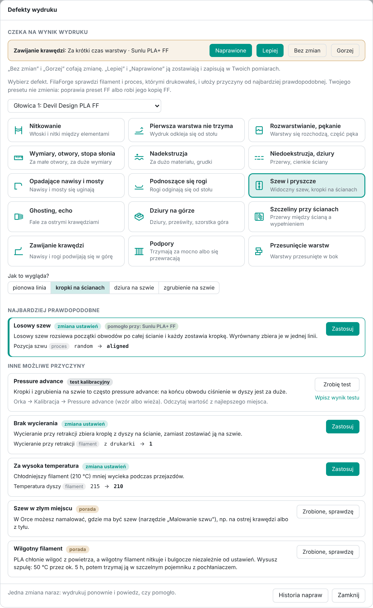

<p align="center">
  <picture>
    <source media="(prefers-color-scheme: dark)" srcset="docs/logo-dark.jpg">
    
  </picture>
</p>

<p align="center">
  <a href="https://github.com/xtronets/filaforge/releases/latest"></a>
  <a href="https://github.com/xtronets/filaforge/actions/workflows/build.yml"></a>
  <a href="LICENSE"></a>
</p>

<p align="center"><b>Polski</b> · <a href="README.en.md">English</a></p>

# FilaForge

Wtyczka do OrcaSlicera, która robi profile filamentów z otwartych baz danych, z karty technicznej producenta
i z Twoich własnych pomiarów. Przy każdej wartości widać, skąd pochodzi i na ile jest pewna.

<p align="center"></p>

## Nowość w 0.9.0: kontrola przed wydrukiem

FilaForge sprawdza teraz pocięty G-code, zanim wyślesz go do drukarki. Po każdym cięciu w Orce czyta plik
w tle i porównuje go z Twoimi pomiarami, presetem i szpulą. Na przycisku **Kontrola** pojawia się liczba
uwag, a każdą poprawiasz jednym kliknięciem.

- **Profil a Twoje pomiary.** Gdy preset ma inne wartości niż zmierzyłeś (przepływ, flow ratio, pressure
  advance, temperatury, retrakcja), FilaForge pokazuje różnice, a **Popraw** zapisuje je w presecie FF.
- **Przepływ według rodzaju ruchu.** Tabela ściany, wypełnienia, mostów i nawisów ze średnią, p95 i p99.
  Czerwony: ponad limit filamentu, pomarańczowy: na granicy, niebieski: ruchy hamowane przez zbyt niski limit
  presetu, choć filament stopi więcej.
- **Przelicz proces i użyj.** Dopasowuje proces, którym cięto, do limitu przepływu filamentu (jak „Proces
  druku dla filamentu”), zapisuje go jako proces FF i od razu wybiera w Orce. Potnij ponownie i uwagi znikną.
- **Limit jest sprawdzony.** Druk na granicy presetu, który znasz z testu, potwierdzasz jednym kliknięciem
  zamiast wracać do kalibracji. **Wpisz wynik testu** otwiera kalkulator pomiarów tego filamentu.
- **Szpula ze Spoolmana.** Ostrzega, gdy na szpuli zostało za mało filamentu na ten wydruk albo na styk.
- **Retrakcje i brzeg.** Za dużo retrakcji na warstwę przy PETG, TPU i PA oraz duża pierwsza warstwa ABS,
  ASA, PC i PA bez brzegu.
- **Kilka filamentów naraz** (np. Snapmaker U1): zużycie każdego i kontrola tego, który drukuje najwięcej.
- **Dane filamentów zapamiętane na pół roku.** Ponowne otwarcie filamentu nie łączy się z internetem.
  Przycisk **Odśwież z internetu** pobiera dane od nowa.
- **Poprawka błędu „Local bundle contains an invalid preset”** przy kolorze filamentu (Orka 2.5 nie
  przyjmuje `filament_colour` w presecie).

Wcześniej (0.8.0): 15 defektów wydruku, historia napraw, testy kalibracyjne i chłodzenie pod materiał.
Szczegóły w sekcji [Kontrola przed wydrukiem](#kontrola-przed-wydrukiem).

## Spis treści

- [Co potrafi](#co-potrafi)
- [Skąd bierze dane](#skąd-bierze-dane)
- [Jak wybiera wartość](#jak-wybiera-wartość)
- [Proces druku dla filamentu](#proces-druku-dla-filamentu)
- [Zwyczaje materiałów](#zwyczaje-materiałów)
- [Kontrola przed wydrukiem](#kontrola-przed-wydrukiem)
- [Przegląd presetów i historia zmian](#przegląd-presetów-i-historia-zmian)
- [Defekty wydruku](#defekty-wydruku)
- [Wymagania](#wymagania)
- [Instalacja, aktualizacja, odinstalowanie](#instalacja-aktualizacja-odinstalowanie)
- [Jak używać](#jak-używać)
- [Ustawienia](#ustawienia)
- [Gdzie co zapisuje](#gdzie-co-zapisuje)
- [Prywatność i sieć](#prywatność-i-sieć)
- [Rozwiązywanie problemów](#rozwiązywanie-problemów)
- [Dla programistów](#dla-programistów)
- [Licencja](#licencja)

## Co potrafi

- **Szuka danych o filamencie** wybranym ze Spoolmana, z Twoich presetów w Orce albo wpisanym ręcznie
  (producent, materiał, odmiana), w kilku źródłach naraz, i pokazuje je w jednej tabeli.
- **Ulepsza presety, które już masz**: na karcie *Z Orki* wybierasz swój preset filamentu, a FilaForge
  uzupełnia go danymi producenta i zapisuje jako nowy preset z dopiskiem FF. Twój preset zostaje bez zmian,
  a jego wartości (np. flow ratio, który ustawiłeś ręcznie) mają pierwszeństwo przed presetami producenta.
- **Czyta karty techniczne (TDS)** producentów: z pliku PDF albo z adresu PDF lub strony produktu. Wyciąga
  temperatury dyszy (także zakresy zależne od prędkości druku), stołu, retrakcję, gęstość, Vicat/HDT i suszenie.
- **Tworzy preset filamentu w Orce** jednym kliknięciem. To samodzielny preset z własnym `filament_id`, więc
  *Synchronizacja z AMS* i agenci drukarek (np. U1 Control) potrafią go dopasować. Nazwa dostaje znacznik
  **FF** (np. `Sunlu PLA+ FF`), a preset jest przypisany do wybranej drukarki.
- **Zapisuje ustawienia w Spoolmanie**, w polu `orca_settings` filamentu, dla wszystkich drukarek albo tylko
  dla tego modelu. Dopisuje brakujące ustawienia, a te, które już są z inną wartością (np. stary flow ratio), nadpisuje tylko
  wtedy, gdy je zaznaczysz. Przed zapisem pokazuje, co doda, co nadpisze i co zostawi.
  Z tych ustawień [Spooler](https://github.com/bloodf/spooler) robi potem presety.
- **Pamięta Twoje pomiary**: temperaturę dyszy i stołu, flow ratio, pressure advance, maks. przepływ
  i retrakcję. Pomiary są per filament, dla wszystkich drukarek albo dla jednej, i zawsze mają pierwszeństwo.
  Pressure advance i maks. przepływ zapisują się osobno dla każdej średnicy dyszy (0.4, 0.6…), bo wartość
  zmierzona na 0.4 jest zła dla 0.6.
- **Pomaga w kalibracji Orki**: dla testów flow ratio (YOLO, Pass 1/2), maks. przepływu, pressure advance,
  temperatury i retrakcji podpowiada, jak odczytać wynik, przelicza go według wzorów z wiki OrcaSlicera
  i wstawia do Twoich pomiarów.
- **Liczy proces druku dopasowany do filamentu**: prędkości obniżone do maks. przepływu, zwyczaje materiału,
  mosty, przyspieszenia, limity drukarki i warianty dla małych detali.
- **Sprawdza pocięty G-code przed wydrukiem**: przepływ każdego rodzaju ruchu, zgodność presetu z Twoimi
  pomiarami, filament na szpuli, retrakcje i brzeg. Każdą uwagę poprawia jednym kliknięciem, a proces potrafi
  przeliczyć i od razu wybrać w Orce.
- **Diagnozuje 15 defektów wydruku**: nitkowanie, pierwszą warstwę, rozwarstwianie, wymiary, nad- i
  niedoekstruzję, nawisy i mosty, podnoszące się rogi, szew i pryszcze, ghosting, dziury na górze, szczeliny
  przy ścianach, zawijanie krawędzi, podpory i przesunięcie warstw. Ustawia przyczyny według materiału,
  ustawień i pomiarów, poprawia jedną rzecz naraz, uczy się z wyniku wydruku i z podobnych filamentów,
  a całą historię napraw pokazuje w jednym miejscu.
- **Zna zwyczaje materiałów**: wolniejsze mosty PETG, nawiew na mostach, komorę i pierwsze warstwy bez nawiewu
  dla ABS/ASA/PC/PA, ostrzeżenie o otwartej drukarce. Wszystkie współczynniki zmienisz w oknie **Materiały**.
- **Ustawia chłodzenie** pod materiał (nawiew min/max, wentylator boczny, minimalny czas warstwy, pełny nawiew
  od warstwy) i pod rodzaj druku: warianty presetu „detale i nawisy” oraz „wytrzymałość”.
- **Pilnuje porządku w presetach**: **Przegląd** wyłapuje brakujące i sprzeczne wartości oraz presety
  nieaktualne po aktualizacji Orki. Ręczne zmiany zrobione w Orce przenosi do Twoich pomiarów.
- **Ma historię zmian**: przed każdym nadpisaniem albo usunięciem presetu FF zachowuje poprzednią wersję,
  którą możesz porównać i przywrócić.
- **Ma interfejs po polsku i po angielsku**, w jasnym i ciemnym motywie Orki.
- **Działa też bez internetu**: korzysta wtedy z presetów Orki, Twoich pomiarów i zapisanych wcześniej odpowiedzi.

## Skąd bierze dane

| Źródło | Co daje | Rodzaj |
|---|---|---|
| [Open Filament Database](https://openfilamentdatabase.org) (MIT) | zakresy temperatur dyszy i stołu, gęstość, maks. przepływ, wentylator, suszenie, adres karty TDS, pasujący preset Orki | producent |
| Karta techniczna producenta (PDF lub strona produktu) | zakres temperatur dyszy dla prędkości druku, stół, retrakcja, Vicat/HDT, gęstość, suszenie | producent |
| [SpoolmanDB](https://github.com/Donkie/SpoolmanDB) (MIT) | temperatury, gęstość | producent |
| Presety OrcaSlicera | preset producenta tego filamentu dla Twojej drukarki oraz ogólny preset materiału | preset / ogólny |
| Twój preset wybrany na karcie *Z Orki* | wartości, z którymi drukujesz teraz; jest bazą nowego presetu | preset (przed presetem producenta) |
| Twoje pomiary i `orca_settings`, które już są w Spoolmanie | wszystko, co skalibrowałeś | zmierzona |

## Jak wybiera wartość

Każde ustawienie w tabeli ma wartość, pochodzenie (kolor), pewność (kreski) i listę wartości z pozostałych
źródeł. Pewność rośnie, gdy źródła się zgadzają.

Kolejność pierwszeństwa:

1. **Zmierzona**: Twój pomiar zawsze wygrywa.
2. **Producent**: wartości deklarowane w bazach i w karcie TDS. Temperatura dyszy i stołu jest wybierana
   w zakresie producenta, według wiarygodności źródeł. Jeśli karta podaje temperatury dla różnych prędkości,
   brany jest zakres pasujący do prędkości procesu Twojej drukarki.
3. **Preset**: wartość z presetu Orki zostaje tylko wtedy, gdy mieści się w zakresie producenta.
4. **Szacunek**: np. maks. przepływ wyliczony z prędkości druku podanej przez producenta.
5. **Ogólny**: wartość z ogólnego presetu materiału, gdy nic lepszego nie ma.

Zaznaczasz, które ustawienia trafią do presetu i do Spoolmana. Ustawienia takie same jak w presecie bazowym
są domyślnie ukryte; pokażesz je linkiem pod tabelą.

## Proces druku dla filamentu

Karta **Proces druku dla tego filamentu** bierze wybrany proces drukarki i robi z niego kopię z dziedziczeniem
(`inherits`). Zmienia w niej tylko to, co trzeba:

- **Prędkości** są ograniczone do maks. przepływu filamentu. Wzór: v = przepływ / (h · (w − h·(1 − π/4))),
  gdzie h to wysokość warstwy, a w to szerokość linii. Dotyczy to ścian, wypełnienia, górnej powierzchni,
  szczelin, małych obwodów, szwu scarf, podpór i ich interfejsu oraz mostów. Dla mostów przekrój liczony jest
  jak dla okrągłej nitki.
- **Zwyczaje materiału**: PETG i PLA Silk mają wolniejsze ściany zewnętrzne i górę. ABS, ASA i materiały z
  włóknem węglowym są trochę wolniejsze, PC i PA ok. 70%. TPU ma ok. 30% prędkości, nie więcej niż 60 mm/s,
  oraz łagodniejsze przyspieszenia. Wszystkie te współczynniki zmienisz sam, zob.
  [Zwyczaje materiałów](#zwyczaje-materiałów).
- **Mosty**: PETG dostaje wolniejsze mosty (×0,8), bo przy wolnym moście z łagodnym nawiewem mniej się
  ciągnie i opada. PLA zostaje bez zmian. Przyspieszenie mostu jest takie, żeby most rozpędzał się do swojej
  prędkości w ok. 25 ms i nie zrywał nitki na starcie (minimum 500 mm/s²).
- **Limity drukarki**: żadna prędkość ani przyspieszenie nie przekracza limitów maszyny z profilu drukarki.
- **Warianty**: *Zwykłe modele*, *Małe detale (do 40 mm)* z wolniejszymi ścianami i przyspieszeniami, albo
  *Według modeli na płycie*. Ten ostatni sam wybiera wariant na podstawie wymiarów modeli na płycie.

Przy każdej zmianie widać wartość „teraz”, „nowa” i powód. Proces zapisuje się w Orce jako
np. `0.20mm Standard Sunlu PLA+ FF`.

## Zwyczaje materiałów

Przycisk **Materiały** w nagłówku otwiera tabelę zasad, które FilaForge stosuje dla każdego rodzaju materiału
(PLA, PLA Silk, PETG/PCTG, ABS, ASA, PC, PA, z włóknem węglowym, TPU). To reguły z doświadczenia, nie dane
producenta, więc możesz je zmienić. Zmiany zapisują się w `settings.json`, a **Przywróć domyślne** wraca do
wartości FilaForge.

- **Prędkości i przyspieszenia (×)**: mnożniki procesu dla ściany zewnętrznej, ścian wewnętrznych, góry,
  wypełnienia, mostów i przyspieszeń. 1 = bez zmian. Puste pole w grupie bierze wartość z kolumny
  „Wszystkie”. Mnożnik tylko obniża prędkość, nigdy jej nie podnosi.
- **Chłodzenie** (druga tabela):
  - **Min i Max (%)** (`fan_min_speed`, `fan_max_speed`): nawiew przy długich i krótkich warstwach. Domyślnie
    PLA i TPU 100/100, PETG 30/60, ABS 10/30, ASA 10/35, PC 0/30, PA 0/40.
  - **Mosty (%)** (`overhang_fan_speed`): nawiew na mostach i nawisach. Domyślnie PLA 100%, PETG 60%, ABS
    i ASA 50%, PC i PA 40%.
  - **Pełny od warstwy** (`full_fan_speed_layer`): od tej warstwy nawiew idzie z pełną mocą. PLA i PETG 3,
    ABS, ASA i PA 4, PC 5.
  - **Min. czas warstwy (s)** (`slow_down_layer_time`): krótsza warstwa zwalnia i dostaje maksymalny nawiew.
    PLA 8, PETG 10, ABS, ASA i PA 12, PC 15.
  - **Boczny (%)** (`additional_cooling_fan_speed`): wentylator pomocniczy. PLA 70%, PETG 20%, materiały,
    które się wypaczają, 0%. Ustawiany tylko wtedy, gdy profil drukarki ma wentylator pomocniczy
    (`auxiliary_fan`).
- **Warstwy bez nawiewu** (`close_fan_the_first_x_layers`): ABS i ASA 3, PC 4, PA 3, żeby pierwsze warstwy
  dobrze trzymały się stołu.
- **Komora** (`chamber_temperature`): ABS i ASA 45 °C, PC 55 °C, PA 45 °C. Ustawiana tylko wtedy, gdy
  profil drukarki ma sterowanie temperaturą komory (`support_chamber_temp_control`). Wtedy FilaForge włącza
  też `activate_chamber_temp_control`.
- **Wymaga obudowy**: ABS, ASA, PC i PA. Gdy drukarka nie grzeje komory i nie wiadomo, czy jest zamknięta,
  wynik i proces pokazują ostrzeżenie z przyciskiem **Moja drukarka jest zamknięta**. FilaForge zapamiętuje
  to dla tej drukarki i zamiast ostrzeżenia radzi rozgrzać wnętrze przed drukiem.

Wartości dla presetu filamentu mają w tabeli wyników znaczek **Szacunek**. Wygrywa z nimi preset producenta,
karta techniczna i Twój pomiar. Zastępują tylko wartość z ogólnego presetu materiału.

## Kontrola przed wydrukiem

Orka zgłasza wtyczce każdy wyeksportowany G-code, także podgląd po cięciu. FilaForge czyta go w tle, nie
spowalniając Orki, i liczy: czas, zużycie filamentu (osobno dla każdego ekstrudera), warstwy, retrakcje
i przepływ w mm³/s dla każdego rodzaju ruchu. Szczyty liczy jako p99, żeby pojedyncze krótkie odcinki nie
dawały fałszywych alarmów.

Potem sprawdza:

| Uwaga | Kiedy | Co możesz zrobić |
|---|---|---|
| Profil nie zgadza się z pomiarami | wartość w presecie różni się od Twojego pomiaru | **Popraw**: zapis w presecie FF |
| Przepływ ponad pomiar | p99 rodzaju ruchu przekracza zmierzony limit | **Przelicz proces i użyj** |
| Druk na granicy presetu | brak pomiaru, a ruchy dochodzą do limitu presetu | **Limit jest sprawdzony** albo **Wpisz wynik testu** |
| Za mało filamentu | szpula ze Spoolmana nie wystarczy albo wystarczy na styk | wymień szpulę |
| Dużo retrakcji | PETG, TPU, PA ponad próg na warstwę | **Popraw**: omijanie ścian przy przejazdach |
| Pierwsza warstwa bez brzegu | ABS, ASA, PC, PA z dużą pierwszą warstwą | **Popraw**: brzeg zewnętrzny |

Twoje presety zostają nietknięte: poprawki idą do presetów i procesów FF. Po poprawce wybierz preset FF
(proces FF wybiera się sam), potnij ponownie i kliknij **Sprawdź ponownie**.

## Defekty wydruku

Przycisk **Defekty** w nagłówku pomaga naprawić to, co wyszło źle na wydruku. Wybierz defekt z listy:

<p align="center"></p>

nitkowanie · pierwsza warstwa nie trzyma · rozwarstwianie i pękanie · wymiary, otwory, stopa słonia ·
nadekstruzja · niedoekstruzja · opadające nawisy i mosty · podnoszące się rogi · szew i pryszcze ·
ghosting (echo) · dziury na górze · szczeliny przy ścianach · zawijanie krawędzi · podpory ·
przesunięcie warstw.

**Diagnoza zamiast jednej stałej poprawki.** Każdy defekt ma kilka możliwych przyczyn. FilaForge ustawia je
od najbardziej prawdopodobnej na podstawie:

- **materiału**: PETG i nylon najpierw do suszenia, ABS/ASA/PC w otwartej drukarce najpierw obudowa,
  PLA w zamkniętej drukarce może przegrzewać radiator;
- **ustawień, którymi drukowałeś**: temperatura w zakresie presetu, retrakcja direct drive albo bowden,
  nawiew, przepływ, brim; poprawka nigdy nie wychodzi poza zakres presetu ani granice materiału
  (np. stół dla PLA najwyżej 65 °C);
- **Twoich odpowiedzi** na 1–2 pytania, np. czy filament był suszony albo gdzie warstwa się nie trzyma;
- **Twoich pomiarów**: wymiary z suwmiarki, grubość pojedynczej ściany, zapisany flow;
- **tego, co już próbowałeś** dla tego filamentu.

Przykłady obliczeń:

- **Wymiary**: z dwóch różnych wymiarów zewnętrznych (np. 20 i 100 mm) FilaForge oddziela skurcz materiału
  (`filament_shrink`) od przesunięcia ścian (`xy_contour_compensation`). Otwory dostają własną kompensację.
  Gdy obrys jest za duży, a otwory za małe o podobną wartość, najpierw każe skalibrować flow.
- **Flow z pomiaru ściany**: kostka w trybie wazy, ściana zmierzona suwmiarką, nowy flow =
  flow × szerokość linii / zmierzona ściana.

Część przyczyn to nie ustawienia: suszenie, mycie płyty, poziomowanie, Z-offset, zatkana dysza, przeciąg,
luźny pasek, kalibracja rezonansu. FilaForge mówi to wprost zamiast zmieniać coś na ślepo.

**Wydruk testowy.** Tam, gdzie lepszy jest test niż zgadywanie, przyczyna wskazuje konkretny test
kalibracyjny Orki (flow, pressure advance, maks. przepływ, wieża temperatur, retrakcja, input shaping) i mówi,
co z niego odczytać. Przycisk **Wpisz wynik testu** przenosi do kalkulatora w „Twoich pomiarach” z wybranym
testem, więc wynik od razu trafia do pomiarów.

**Jedna zmiana naraz i pętla po wydruku.** Zmiana trafia do presetu FF filamentu albo procesu (z historią
zmian). Gdy drukowałeś na swoim presecie, FilaForge robi jego kopię FF i dopiero ją poprawia. Po wydruku
odpowiadasz w tym samym oknie:

| Odpowiedź | Co się dzieje |
|---|---|
| Naprawione, Lepiej | Zmiana zostaje. Wartości filamentu trafiają do Twoich pomiarów, więc następny preset też je dostanie. Przy „Lepiej” plan może zaproponować kolejny krok tej samej przyczyny. |
| Bez zmian, Gorzej | Zmiana jest cofana, a ta przyczyna spada na dół listy. Przechodzisz do następnej. |

**Historia napraw.** Przycisk **Historia napraw** w oknie Defektów pokazuje wszystkie próby dla filamentu na
stole (albo dla wszystkich filamentów): defekt, przyczynę, zmienione wartości, preset, wynik i datę.
FilaForge uczy się z niej: poprawka, która pomogła przy innym filamencie tego samego rodzaju na tej samej
drukarce, idzie w planie wyżej i ma znaczek „pomogło przy: …”, a ta, która nie pomogła, trochę niżej.

## Przegląd presetów i historia zmian

Przycisk **Przegląd** w nagłówku sprawdza presety filamentów zrobione przez FilaForge i Twoje własne.
Liczba przy przycisku pokazuje, ile rzeczy warto sprawdzić. Presetów spoza FilaForge wtyczka nigdy nie zmienia.
Może je tylko otworzyć w FilaForge, żeby zrobić z nich nowy preset.

| Co sprawdza | Co możesz zrobić |
|---|---|
| **Zmieniłeś wartość ręcznie w Orce**: PA, flow, maks. przepływ, temperatury, retrakcję albo nawiew w presecie FF albo w presecie zapisanym na jego podstawie | **Zapisz jako mój pomiar**: wartość trafia do Twoich pomiarów (dla tej drukarki i średnicy dyszy), więc następny preset też ją dostanie. Gdy preset był zrobiony ze szpuli, także do Spoolmana. Albo **Zostaw, nie pytaj**. |
| **Twój pomiar różni się od presetu FF** | **Wpisz pomiar do presetu** |
| **Orka zaktualizowała preset bazowy** (np. po aktualizacji Orki) | **Odśwież na nowej bazie**: nowe wartości bazy, a to, co ustawiło FilaForge i co zmieniłeś, zostaje |
| Preset bazowy zniknął, plik presetu usunięty ręcznie, Orka nie wczytała presetu | Usuń z listy, Napraw (procesy), Usuń |
| Brak maks. przepływu, PA włączone, ale równe 0, temperatura poza zakresem presetu, min. nawiew większy od maks., brak presetu nadrzędnego | **Otwórz w FilaForge** |
| Presety o identycznych ustawieniach | informacja, duplikat FF możesz usunąć |

Przegląd uruchamia się też sam przy otwarciu zakładki. Gdy zauważy ręczną zmianę w Orce, pokaże o tym komunikat.

**Historia zmian** (okno **Zapisane** → **Historia zmian…**): zanim FilaForge nadpisze albo usunie swój preset,
zachowuje poprzednią wersję, do 20 na preset. Każdą możesz porównać z obecną (**Pokaż zmiany**) i przywrócić.
Przywrócenie też zachowuje bieżącą wersję, więc da się je cofnąć. Usunięty preset wraca razem z
informacją, dla której drukarki i szpuli był zrobiony.

## Wymagania

- OrcaSlicer **2.5** lub nowszy, z obsługą wtyczek, na **Windows, macOS albo Linuksie**. Wtyczka to czysty
  Python bez dodatkowych bibliotek, więc jeden plik `.whl` działa na każdym systemie.
- Opcjonalnie [Spoolman](https://github.com/Donkie/Spoolman), żeby wybierać szpule i zapisywać ustawienia. Bez niego wszystko inne działa.
- Opcjonalnie [Spooler](https://github.com/bloodf/spooler). Jeśli go masz, FilaForge sam weźmie z niego adres Spoolmana.

## Instalacja, aktualizacja, odinstalowanie

**Instalacja**

1. Pobierz `filaforge_any.whl` z [Releases](https://github.com/xtronets/filaforge/releases/latest).
2. W Orce otwórz menu **Wtyczki**. W Windows i Linuksie jest pod ▾ obok menu Plik, w macOS w pasku menu u góry
   ekranu.
3. Kliknij **Zainstaluj lokalną wtyczkę** i wskaż pobrany plik.
4. Zaznacz **Aktywuj** i zezwól na to, o co wtyczka prosi: wątek w tle, własny folder i adresy sieciowe
   opisane w [Prywatność i sieć](#prywatność-i-sieć).
5. Obok zakładek Przygotuj, Podgląd i Urządzenie pojawi się zakładka **FilaForge**.

**Aktualizacja**: zainstaluj nowy plik `.whl` tak samo, a potem uruchom Orkę ponownie. Twoje ustawienia,
pomiary i presety zostają.

**Odinstalowanie**: usuń wtyczkę w menu **Wtyczki**. Presety zrobione przez FilaForge usuniesz wcześniej
w oknie **Zapisane** albo w Orce. Folder `<dane Orki>/filaforge/` możesz potem skasować ręcznie.

## Jak używać

1. **Wybierz filament.** Na karcie *Ze Spoolmana* wybierz szpulę z listy (jest wyszukiwarka). Na karcie
   *Z Orki* wybierz swój preset filamentu dla tej drukarki; producenta, materiał, odmianę i kolor FilaForge
   odczyta z presetu. Na karcie *Ręcznie* wpisz producenta, materiał i odmianę; podpowiedzi odmian pochodzą
   z Open Filament Database.
2. **Opcjonalnie dodaj kartę TDS**: wklej adres PDF lub strony produktu albo wybierz plik PDF z dysku.
3. Kliknij **Szukaj danych**. Pasek źródeł pokazuje, co znalazło się w każdym z nich.
4. **Przejrzyj tabelę** i odznacz to, czego nie chcesz.
5. Kliknij **Utwórz preset w Orce**. Preset pojawi się w Filament → Presety użytkownika.
6. Opcjonalnie kliknij **Zapisz w Spoolmanie…**: wybierz sekcję (wszystkie drukarki albo tylko ten model),
   sprawdź plan i zatwierdź.
7. Po kalibracji wpisz wyniki w **Twoje pomiary**. Możesz też użyć **Kalibracja w Orce**: wybierz test, wpisz to,
   co odczytałeś z wydruku (np. modyfikator bloku albo wysokość), i kliknij **Wstaw do pomiarów**. Na koniec
   kliknij **Zapisz pomiary i przelicz**.
8. W **Proces druku dla tego filamentu** wybierz proces i wariant, kliknij **Przelicz**, a potem
   **Zapisz proces w Orce**.

**Bez Spoolmana** wtyczka działa normalnie: od razu otwiera się karta *Z Orki* z Twoimi presetami (albo
*Ręcznie*, jeśli własnych presetów nie masz), a przycisk zapisu do Spoolmana jest ukryty. Wyszukiwanie danych, presety, Twoje pomiary i proces druku działają tak samo.

Przycisk **Zapisane** w nagłówku pokazuje wszystkie presety i procesy zrobione przez FilaForge. Tam też je usuniesz.

**Chłodzenie pod druk**: OrcaSlicer trzyma wszystkie ustawienia wentylatorów w presecie filamentu, a nie
w procesie. Dlatego obok nazwy presetu wybierasz chłodzenie, a FilaForge robi osobny preset filamentu:
- **Standard**: wartości z tabeli wyników.
- **Detale i nawisy**: maksymalny nawiew +20 punktów, nawiew mostów i wentylator boczny +20, minimalny czas
  warstwy +4 s. Materiały, które się wypaczają, dostają najwyżej 50%. Do nazwy dochodzi „detale”.
- **Wytrzymałość**: nawiew min i max ok. 60%, wentylator boczny o połowę, mosty bez zmian. Warstwy wiążą się
  mocniej, więc to dobry wybór na części użytkowe. Do nazwy dochodzi „wytrzymały”.

**Nazwy presetów**: FilaForge dodaje znacznik **FF** i nie dopisuje `@drukarka`. Jeśli preset o tej samej
nazwie istnieje już dla innej drukarki, do nazwy dochodzi model w nawiasie, np. `Sunlu PLA+ FF (Snapmaker U1)`.

## Ustawienia

| Ustawienie | Opis |
|---|---|
| Adres Spoolmana | np. `http://192.168.1.2:7912`. Gdy pole jest puste, a masz Spoolera, użyty jest adres ze Spoolera. |
| Język | Automatycznie (według języka systemu), polski albo angielski. |
| Szukaj w internecie | Wyłączone = tylko presety Orki, Twoje pomiary i zapisane wcześniej odpowiedzi. |
| Materiały (osobny przycisk) | Współczynniki i szacunki dla każdego materiału, zob. [Zwyczaje materiałów](#zwyczaje-materiałów). |

## Gdzie co zapisuje

`<dane Orki>` to folder danych OrcaSlicera: `%APPDATA%\OrcaSlicer` w Windows,
`~/Library/Application Support/OrcaSlicer` w macOS i `~/.config/OrcaSlicer` w Linuksie (we Flatpaku
`~/.var/app/io.github.softfever.OrcaSlicer/config/OrcaSlicer`). FilaForge znajduje go sam.

| Co | Gdzie |
|---|---|
| Presety filamentów i procesów | osobny pakiet **FilaForge** w Twoich presetach użytkownika: `<dane Orki>/user/<konto>/_local/filaforge/` |
| Ustawienia | `<dane Orki>/filaforge/settings.json` |
| Twoje pomiary | `<dane Orki>/filaforge/measured.json` |
| Historia zmian presetów | `<dane Orki>/filaforge/history/` |
| Historia napraw defektów | `<dane Orki>/filaforge/defects.json` |
| Presety odrzucone przez Orkę | `<dane Orki>/filaforge/refused/` (do dołączenia do zgłoszenia błędu) |
| Pamięć podręczna odpowiedzi z internetu | `<dane Orki>/filaforge/cache/`. Dane filamentów są trzymane pół roku; **Odśwież z internetu** pobiera je od nowa. Gdy sieci nie ma, użyta jest starsza kopia. |
| Dziennik | `<dane Orki>/filaforge/filaforge.log` |
| Ustawienia w Spoolmanie | pole dodatkowe `orca_settings` filamentu. Gęstość, średnica i cena zostają w zwykłych polach Spoolmana. |

## Prywatność i sieć

FilaForge łączy się tylko z:

- `api.openfilamentdatabase.org` (Open Filament Database),
- `api.github.com` i `raw.githubusercontent.com` (SpoolmanDB i presety OrcaSlicera),
- Twoim Spoolmanem,
- stronami kart TDS, które sam podasz.

Nie wysyła żadnych danych o Tobie ani o Twoich wydrukach. Do Spoolmana zapisuje tylko to, co zatwierdzisz.

Orca pyta o zgodę na adresy przy starcie wtyczki. Kiedy podasz kartę TDS z nowej strony, FilaForge zapamięta
ten adres i poprosi o niego przy następnym uruchomieniu Orki. Do tego czasu możesz wybrać plik PDF z dysku.

## Rozwiązywanie problemów

- **Ikona zakładki się nie zmieniła po aktualizacji.** Zamknij Orkę całkowicie i uruchom ją ponownie.
  Orka przy starcie rozpakowuje wtyczkę ze swojej kopii pliku `.whl`, więc aktualizuj ją przez
  *Zainstaluj lokalną wtyczkę*, a nie przez podmianę plików.
- **„Ustaw adres Spoolmana w Ustawieniach.”** Wpisz adres Spoolmana w **Ustawienia** albo skonfiguruj go w Spoolerze.
- **Karta TDS z nowej strony nie chce się pobrać.** Uruchom Orkę ponownie i zezwól na nowy adres albo wybierz plik PDF.
- **Brak presetu producenta.** FilaForge użyje ogólnego presetu materiału i powie o tym w pasku źródeł.
- **„Local bundle contains an invalid preset”.** Od 0.7.1 FilaForge naprawia to sam (w 0.9.0 doszła przyczyna z kolorem filamentu): preset, którego Orka nie
  przyjmuje, robi samodzielnym albo odkłada do Historii, a wartość, której nie przyjmuje, bierze z presetu
  bazowego. Jeśli błąd zostaje, dołącz do zgłoszenia plik z folderu `refused/`.
- **Coś poszło nie tak.** Szczegóły są w `<dane Orki>/filaforge/filaforge.log`. Zgłoś błąd w
  [Issues](https://github.com/xtronets/filaforge/issues) i dołącz ten plik.

## Dla programistów

```
python3 -m unittest discover -s tests          # rdzeń i wtyczka, z udawaną Orką
python3 scripts/build.py                       # dist/filaforge_any.whl
python3 scripts/vendor_pypdf.py pypdf-*.whl    # odświeżenie dołączonego czytnika PDF
```

- `src/filaforge/core/`: rdzeń bez zależności od Orki (źródła, scalanie, pomiary, procesy, zapis presetów, Spoolman).
- `src/filaforge/plugin.py` i `__init__.py`: zakładka w Orce i obsługa wiadomości ze strony.
- `src/filaforge/ui/page.html`: interfejs (PL/EN).
- `src/filaforge/_vendor/pypdf/`: dołączony [pypdf](https://github.com/py-pdf/pypdf) 5.4.0 (BSD).

**Testy na trzech systemach**: workflow *Build* uruchamia testy na Windows, macOS i Linuksie, a dopiero potem
buduje `filaforge_any.whl`.

**Test w prawdziwej Orce**: workflow *Real OrcaSlicer* uruchamia Orkę dla Linuksa (2.5.2 i najnowszą) na wirtualnym
ekranie z czystym katalogiem danych i zainstalowaną wtyczką. Wtyczka sama się testuje (`src/filaforge/selftest.py`,
tylko przy ustawionej zmiennej `FILAFORGE_SELFTEST`): API wtyczek, presety, wyszukiwanie, zapis i usuwanie presetu
i procesu. Drugie zadanie sprawdza w przeglądarce, czy w niskim oknie żadna karta nie jest ucinana
(`tests/layout_check.py`). Workflow działa przy każdej zmianie i co tydzień, żeby nowa Orka nie zepsuła wtyczki
niezauważenie.

**Wydanie nowej wersji**: podnieś `VERSION` w `src/filaforge/plugin.py`, wypchnij zmiany i opublikuj na
GitHubie wydanie z tagiem `v<VERSION>`. Workflow *Build* uruchomi testy, zbuduje `filaforge_any.whl`
i dołączy go do wydania. Workflow *Publish to Orca Cloud* wyśle tę samą wersję do Orca Cloud
(repozytorium musi być połączone w Orca Cloud: *Edit plugin → GitHub publishing*).

## Licencja

[MIT](LICENSE) © xtronets. Dane pochodzą z Open Filament Database i SpoolmanDB (obie MIT) oraz z presetów
OrcaSlicera. Dołączony pypdf jest na licencji BSD.
